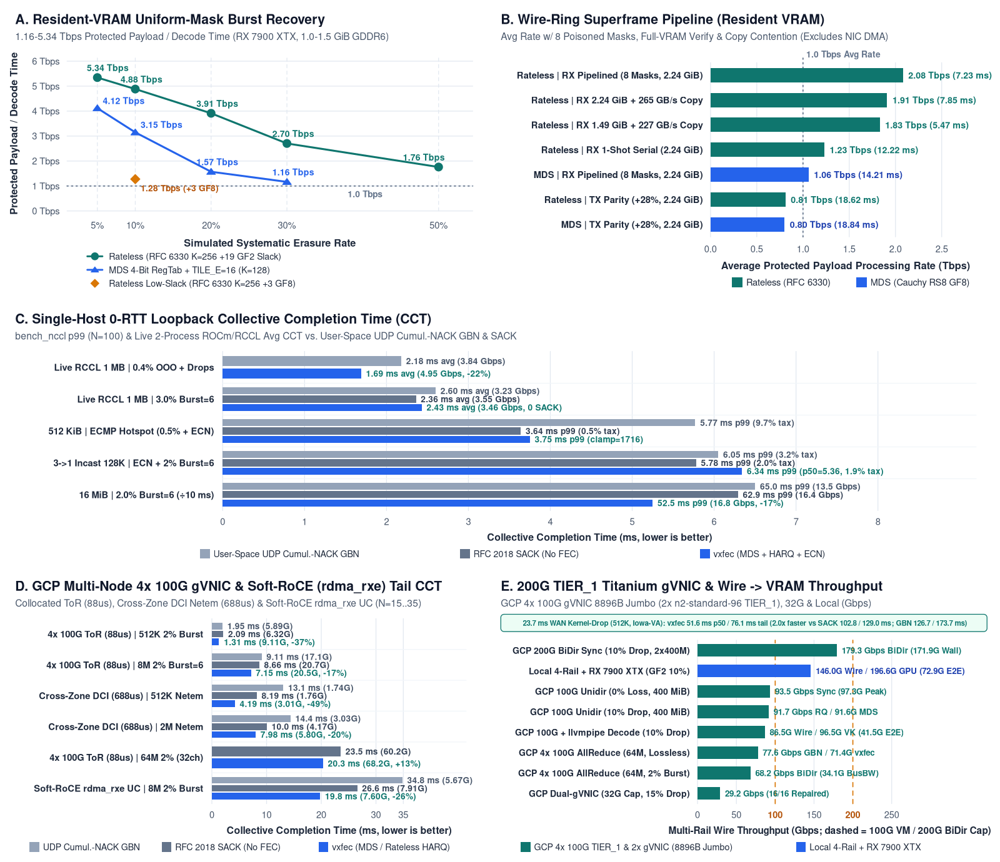

# vxfec

`vxfec` provides GPU-accelerated forward error correction (FEC) and a multi-path collective transport for lossy Ethernet, RoCEv2, and cross-datacenter links. Instead of stalling GPU collectives on retransmission timeouts when packets drop or arrive out of order across ECMP paths, `vxfec` sprays traffic across rails and repairs erasures using Cauchy Reed-Solomon (`GF(256)`) and RaptorQ (`RFC 6330`) hybrid ARQ.

Building the repository produces:

- **`libnccl-vxfec.so`** — a drop-in NCCL / RCCL Net v8 plugin (`vxfec-ecmp-harq`) supporting multi-NIC UDP and `libibverbs` (`IBV_QPT_UC`) RDMA, with `DMA-BUF` GPU memory registration.
- **`libvxfec.a` / `libvxfec_vk.a`** — embeddable C11 + Vulkan 1.2 compute libraries for standalone GPU erasure coding and 2D burst-interleaved superframe recovery.



*On the CPU-only intra-zone link with 2% burst loss, SACK reached 63.0 Gbps on a 64 MiB AllReduce (16 channels) versus 58.7 Gbps for `auto` FEC (68.2 vs. 60.2 Gbps at 32 channels). On the cross-zone and WAN runs, vxfec had lower tail completion times than SACK.*

## Quick Start

### Prerequisites

- Linux with a C11 compiler (`gcc` or `clang`) and `make`
- Vulkan 1.2 loader and headers (`libvulkan-dev`) plus a Vulkan compute driver (AMD RADV, NVIDIA, Intel ANV, or Mesa `lavapipe` CPU fallback via `mesa-vulkan-drivers`)
- *Optional*: `libibverbs-dev` for RDMA Verbs (`IBV_QPT_UC`) support (auto-detected at build time)
- *Optional*: NVIDIA CUDA + NCCL (`libnccl.so.2`) or AMD ROCm + RCCL (`librccl.so.1`) to run `./demo_nccl_e2e`

### Build & Test

```sh
git submodule update --init --recursive
make -j$(nproc)
make check
make -j$(nproc) asan   # isolated Clang ASan + UBSan build & test suite in build-asan/
```

Pass `CPPFLAGS="-DVXFEC_ENABLE_SIM=0"` when building `libnccl-vxfec.so` for production deployments to compile out the fault/congestion simulator hooks.

## Using the NCCL / RCCL Plugin

Point `NCCL_NET_PLUGIN` at `libnccl-vxfec.so`, select `vxfec-ecmp-harq`, and specify your routable NIC(s) via `VXFEC_NCCL_IFNAMES` (or `NCCL_SOCKET_IFNAME`; when neither interface nor bind IP is set, the plugin binds only to `127.0.0.1` loopback):

```sh
export NCCL_NET_PLUGIN="$PWD/libnccl-vxfec.so"
export NCCL_NET="vxfec-ecmp-harq"
export VXFEC_NCCL_IFNAMES="eth0,eth1"   # required for multi-host runs (or set NCCL_SOCKET_IFNAME)
```

### Common Configuration Variables

| Variable | Default | Description |
| :--- | :--- | :--- |
| `VXFEC_NCCL_IFNAMES` | `NCCL_SOCKET_IFNAME` (`lo` if unset) | Comma-separated interface filter (required for multi-host runs; supports NCCL `^` exclude and `=` exact prefixes). |
| `VXFEC_NCCL_BACKEND` | `udp` | Transport backend: `udp` or `ibv` (`libibverbs` `IBV_QPT_UC`, falls back to UDP if unavailable). |
| `VXFEC_NCCL_PORTS` | `16` | Multi-path spray fanout per channel: `1–32` UDP ports; `ibv` supports `1–16` QPs (selects `8` when set to `17–32`). |
| `VXFEC_NCCL_CODEC` | `auto` | Recovery policy: `auto`, `rs8` (Cauchy MDS), `rq-gf256`, `rq-gf2` (pure-`GF(2)` fountain mode), `sack`, or `gbn` (cumulative-NACK Go-Back-N). |
| `VXFEC_NCCL_SLICE_KB` | `384` | Slice messages above this threshold into pipelined Cauchy RS8 sub-blocks (`0` disables). |
| `VXFEC_NCCL_VULKAN` | `1` | Enable async Vulkan GPU FEC offload (`0` forces CPU SIMD FEC while keeping `ibv_reg_dmabuf_mr` GPUDirect RDMA active). |
| `VXFEC_VK_DEVICE` | *(auto)* | Vulkan physical device index override (auto-matches exported `DMA-BUF` GPU affinity on multi-GPU nodes). |

## C Libraries & Wire Compatibility

For applications embedding GPU erasure coding or 2D burst-interleaved streaming directly:

- **[`include/vxfec_vk.h`](include/vxfec_vk.h)** — Vulkan 1.2 compute context, multi-GPU `DMA-BUF` device matching (`vxfec_vk_ctx_new_for_dmabuf`), timeline-semaphore async polling (`vxfec_vk_poll_status`), and zero-copy `DMA-BUF` sub-range (`vxfec_vk_buf_import_fd_range`) and page-aligned host memory (`VK_EXT_external_memory_host`) buffer import/export.
- **[`include/vxfec_rs_cauchy.h`](include/vxfec_rs_cauchy.h)** — Strict MDS Cauchy Reed-Solomon over $\text{GF}(2^8)$ (`K + M <= 256`), bit-exact on the wire with [`nanors`](https://github.com/sleepybishop/nanors) (`0x11d` polynomial, Sunshine / Moonlight / GameStream compatible).
- **[`include/vxfec_rq.h`](include/vxfec_rq.h)** — Rateless RaptorQ (`RFC 6330`, plus pure-`GF(2)` fountain mode when built with `NANORQ_HAS_GF2_MODE`), bit-exact on the wire with [`nanorq`](https://github.com/sleepybishop/nanorq) so CPU-encoded symbols decode on GPU and vice versa.
- **[`include/vxfec_interleave.h`](include/vxfec_interleave.h)** — Directional or full-duplex 2D VRAM superframe ring (`vxfec_wire_ring`) that interleaves `Z` source blocks in wire arrival order to absorb contiguous link blackouts.

## Benchmarks & Demos

```sh
# GPU codec, resident-VRAM loss sweep & 2D superframe pipeline microbenchmarks
./bench_vulkan
./bench_pipeline

# Multi-rail wire -> VRAM superframe benchmark (loopback self-test, or 2-node --mode rx / --mode tx)
./bench_wire_net --self-test

# Standalone plugin AllReduce benchmark (reports NCCL AlgBW, BusBW & aggregate wire goodput)
./bench_nccl
VXFEC_NCCL_IFNAMES=<rank0-nic> ./bench_nccl --rank 0 --master <rank0-ip>:29600
VXFEC_NCCL_IFNAMES=<rank1-nic> ./bench_nccl --rank 1 --master <rank0-ip>:29600

# Live GPU ncclAllReduce A/B demo across lossless, reordering, and burst-loss phases
./demo_nccl_e2e
```

Run a one-direction GPU-to-GPU RDMA UC check on two RDMA-capable hosts with Vulkan DMA-BUF export:

```sh
# Receiver
./bench_wire_net --mode rx --bind <receiver-ip> --gdr

# Sender
./bench_wire_net --mode tx --peers <receiver-ip> --gdr --blackout-pct 10 --csv gdr.csv
```

`--gdr` requires DMA-BUF registration at both endpoints. Use `--sym-t` to lower the default 4096-byte symbol size if the RDMA path MTU is smaller. The sender encodes a test superframe in GPU memory before timing, then the NIC reads it directly. The receiver recovers in GPU memory and reads the result back for byte-for-byte verification. This baseline runs one superframe at a time and records passing runs as `ibv-gdr` in the CSV.

Add `--pipeline` to both endpoints to receive into two registered GPU buffers. A worker recovers and verifies one superframe while the NIC fills the other. The sender still uses the same pre-encoded superframe. Pipeline runs use the `ibv-gdr-pipeline` CSV label.

```sh
# Receiver
./bench_wire_net --mode rx --bind <receiver-ip> --gdr --pipeline

# Sender
./bench_wire_net --mode tx --peers <receiver-ip> --gdr --pipeline --iters 100 --blackout-pct 10 --csv gdr.csv
```

For a baseline comparison, run the same commands with `--pipeline` removed. The receiver reports verified payload goodput across the run and p99 latency from granting each frame's receive buffer to completing recovery and verification. The CSV keeps the per-frame metrics for the best passing wire iteration.
